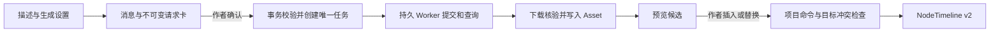
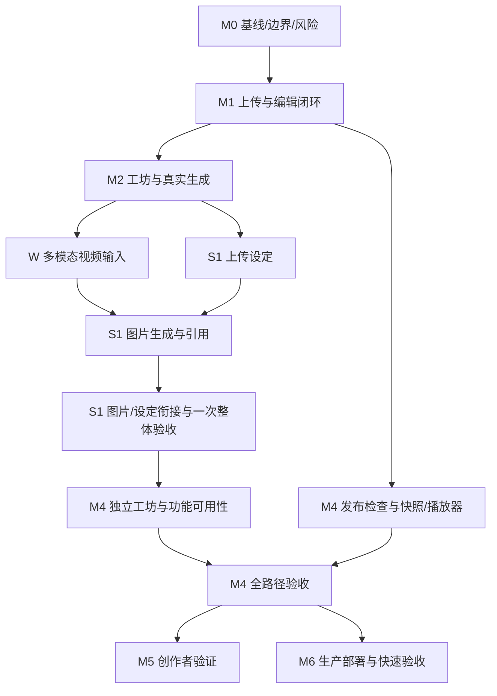

# Infinite Interaction · P0 开发与验收方案

日期：2026-10-04 ｜依据：当前 specs 与已批准独立增量 ｜状态：本期优先独立 AI 工坊与编辑/生成/采用/发布可用性；计划只列本期范围。T79 本地清理已完成，其他未通过项仍待验收；本次仅整理文档，不改代码、数据或部署。

## 1. 交付目标与范围

基于 OpenFMV 现有画布、NodeTimeline v2 和播放器，交付单人项目的浏览器互动视频创作工具。作者可通过上传完成故事、剪辑、互动、试玩和 Web 发布；也可通过项目共享对话确认视频请求，生成后明确插入或替换素材。

产品需求唯一来源为 [规格入口](../docs/specs/README.md) 及其 01–09 文件。本方案只拆分实施，不取代规格；新增设计决策须记录依据并同步相关规格。完整任务见 [todo.md](todo.md)。需求和验收沿用既有编号，空号不复用；以 specs/04 所列 50 项有效 AC 为准，AC-45 仅保留撤销记录。1.2 的详细增量见 [06](../docs/specs/06-reference-library-and-image-generation.md)，模型来源与新任务费用以 08/09 为准。

P0 不增加 AI 编剧、故事拆解、玩法代理、声音生成/克隆、变量系统、多人协作、支付、Electron 交付或新的剪辑内核。已批准的 08 模型来源双模式保留，不恢复旧的个人模型禁用约束。图像生成继续纳入 S1：文字生图/参考图生图、媒体设定及显式引用；不自动建设定或联动剧情。AI 工坊是唯一创作 AI 界面。3–5 分钟测试作品是验收样例，不是产品上限。

## 2. 本轮核查事实

| 对象 | 2026-09-16 读取结果 | 对实施的影响 |
| --- | --- | --- |
| 工作区根 Git | HEAD `2a446eb30fd53e73e6e7ac8b8c2a1048b6450bbb`；原根应用多项 tracked 文件显示删除，三个项目目录和 docs 未跟踪 | 不执行 reset、clean、全量暂存或恢复删除；根仓库与嵌套仓库分别处理 |
| OpenFMV | 独立 Git，HEAD `d1ca0161a539a6fee463fa75f20e115920457cce`；`.gitignore` 已修改，`sample-projects/` 未跟踪 | 保留用户变更；实施前重新采集基线，不能假设仍是本次状态 |
| 技术栈 | package.json 声明 Next 16.2.7、React 19.2.7、TypeScript、Zustand、React Flow、Vitest；存在 node_modules | 沿用项目栈；本轮未核验安装依赖与锁文件完全一致，也未跑测试或构建 |
| UXdemo | index.html 加载 v06-model、model-config、v06-app 及对应 CSS；旧 workflow/studio 脚本不再加载 | 使用当前交互，不能恢复历史四阶段审批 |
| MVPdemo | README/UPSTREAM 描述为同一 OpenFMV 基线的独立本地二开；仍有四阶段流程与 Mock 生成 | 可借鉴测试素材、导入/导出适配，但不作为新产品规格或默认开发入口 |
| 交互访问 | 内置浏览器安全策略阻止 file:// 访问 | 本轮仅作源码/文档/测试脚本分析，没有完成浏览器或视觉验收；未绕过限制 |
| 技能附件 | planning-and-task-breakdown 的 references/definition-of-done.md 不存在 | 以本方案第 7 节和 specs/04 建立完成标准，不虚构附件规则 |

### 2.1 已定位的工程差距

- `app/_features/project-session/store.ts` 已提供 Repository 接口，可接云端适配；现有 revision 是客户端计数，载入重置为 0，不能直接用作服务端乐观锁。当前选中/视口等状态与工程编辑要区分。
- `app/_features/node-timeline/commands.ts` 已有插入、裁剪、分割、移动、复制、删除与音轨命令；`app/_types/index.ts` 中互动仅为 button，mode 为 normal/qte。AGENTS 中列出的更多类型不代表已经实现。
- `app/_utils/timelineOutputEdges.ts` 使用 `node:default`、`button:<clipId>:click/timeout` 出口，edges 是目标关系来源。现有清理函数删除不存在目标的边，必须调整为可保存并定位未修复引用；不增加第二套可编辑 target 值。
- `EditorCanvas.tsx` 的 onNodeClick 当前仅选择节点，与单击进入剪辑器存在差距；标题拖动、菜单、端口和修饰键多选需要分别处理。
- `app/api/local-asset/route.ts` 读取本机路径，`app/api/ai-settings/agents/route.ts` 包含本机 Agent 探测/调试信息。这些本地能力必须从 SaaS 可达路由中隔离，不能把原应用直接公开。
- `scripts/build.js` 不允许 dev/build 共享 `.next` 并行运行，build 还执行 IPC/standalone 相关准备。M0 记录现有脚本基线，SaaS 构建入口再做最小适配。

以上是源码事实及实现风险，均不等于已重现的功能测试结论。

## 3. 架构决策

### 3.1 代码与运行边界

按用户最新约束，以独立的 `InfiniteInteraction/` 为唯一正式应用代码入口，保留 Next.js + React Flow + NodeTimeline 的组件与命令。M0 冻结目录、分支和复用文件清单；UXdemo 保留为交互参考，MVPdemo 保留为历史实验和测试素材来源，不同步维护三份生产内核。

`OpenFMV/AGENTS.md` 要求未获需求授权时不新增云端；本次用户提供的 P-01/P-05/P-11 已明确要求账号、PostgreSQL 和云素材，因此属于本方案范围。涉及目录选择仍以用户后续明确指示为准。

一个应用代码库内增加服务端领域模块、API 和独立持久 Worker。拟采用 PostgreSQL 保存业务数据及任务租约，对象存储保存媒体；是否引入额外队列须由实际负载与恢复要求证明，不默认添加 Redis 或微服务集群。认证、数据库客户端、存储厂商和部署平台在 M0 决策记录中锁定；本轮不宣称任何具体外部产品已验证。

### 3.2 真源与命令

| 数据 | 真源 | 必须保持的约束 |
| --- | --- | --- |
| 工程 | PostgreSQL Project + graphDocument | schemaVersion 与 timeline.version 独立；node.data.timeline 是唯一编辑时间线 |
| 出口 | graph edges + 已有 handle 身份 | 属性区与画布读写同一关系；失效引用可诊断，不静默改向 |
| 素材 | Asset + 私有 storageKey | 文件不可原地覆盖；永久身份为 assetId，签名 URL 只作访问凭证 |
| 设定 | 项目内 Reference 公共基础＋类型扩展 | 名称/简介/至少一同类文件必填，旧文字/other 独立兼容；不复制素材 |
| 编辑记录 | CommandRecord + 服务端 revision | commandId 幂等；授权、校验、工程及记录原子写入 |
| 对话 | Conversation/Message/GenerationRequest | 每项目一段持久会话；未发送输入仅在当前组件，确认请求和执行任务独立 |
| 任务 | GenerationJob + 冻结请求 | requestId 唯一 job；固定作者输入、显式文件与模型版本，不自动绑定编辑目标；Worker 可恢复，费用按 09 |
| 配置 | 版本化模型 + secret 引用 | 模型来源和权限按 08；Key 不回读；停用不使活动任务失去原配置 |
| 发布 | PublishedVersion + 固定 snapshot/manifest | 固定 sourceRevision，只公开所需素材；失败不覆盖旧版本 |
| 编辑会话 | 按项目/场景保存的 EditorSession | 选择、播放头、滚动和面板不推进作品 revision；失败有本地救援副本 |

服务器从会话派生 actor，不信任客户端声明的身份。客户端串行提交项目命令，可合并连续拖动；服务端用 baseRevision 拒绝旧版本。重传同一命令返回原结果；撤销/重做本身也是有 revision 校验的项目命令。

### 3.3 生成与采用

优先使用确定性请求整理和可编辑设置，不引入通用语言模型。确认前零生成任务、零生成额度预留。旧请求被替代/取消/过期后不可确认；变更配置或估价需重新确认，不静默换供应商。图片按 outputKind 分流，复用持久任务/素材/对话；模型默认按输出类型独立，保留旧视频默认与任务快照，不直接沿用视频价。

任务区分 submitting 未知、运行、入库、终态。未知提交先对账；没有可靠幂等或查询能力时保留待核实状态，不自动再次付费。供应商成功但下载失败仅重试入库。当前新任务按 09 使用 `estimate_only` / `none`，不操作旧项目额度；失败/取消不承诺未核实退款。旧 `legacy` 任务仍按冻结账务语义恢复，历史 `approved_ceiling` 仅为原授权范围的项目内部记账，不代表供应商实扣。

生成仅生产项目素材，提交前不要求选择场景/片段，不从编辑器捕获目标；工坊当前组件保留文本、模型、参数、输出类型和显式参考文件，离开工坊、切项目或刷新后丢弃。作者在采用时手动选择场景或目标片段，复用项目命令；按目标片段及其媒体/时间线指纹判断冲突：无关 revision 变化可以安全继续；目标修改必须重新选择。替换保留 clipId、起点和出口；媒体过短要求显式处理；只标记相关互动。撤销不会删除素材、任务、对话、配置或供应商费用。项目所有权、请求输入快照与手动采用目标校验必须有效。

### 3.4 安全边界前置

SaaS 不暴露本机文件、CLI 探测/执行或 Electron 专属接口。项目、素材、对话、任务、参考输入及版本管理均校验所有权；管理员配置另行授权。浏览器仅提交新 Key，服务端存 secret 引用，日志及导出脱敏。

供应商 Base URL、重定向和下载执行地址白名单、DNS/IP 检查和出站限制；extraBody 由适配器 schema 限制。上传及媒体探测有真实文件类型、大小、时长与处理资源上限。发布只暴露固定版本所需资源，不能公开项目桶。

## 4. 开发顺序与依赖

| 阶段 | 任务 | 阶段可演示结果 | 退出门槛 |
| --- | --- | --- | --- |
| M0 基线与关键风险 | T01–T03 | 编辑/试玩基线、复用清单、云方案及迁移样例 | 基线失败已分类，核心模型与环境决策可执行 |
| M1 无 AI 编辑闭环 | T04–T24 | 新建、云保存、上传、画布、剪辑、四模板、设定、导入、试玩 | 关闭 AI 完成可重新打开的分支草稿，保存冲突不丢数据 |
| M2 真实生成闭环 | T25–T42 | 管理配置、对话确认、持久任务、真实结果、插入/替换 | 文生/图生视频真实可播，重启/未知提交/入库恢复可验证 |
| S1 设定与图片生成增量 | T64–T76、T78 | 五个交付包：设定库、图片服务、工坊图片交互、图片/设定衔接、整体验收 | AC-43～52（AC-45 已撤销）、AC-54 工坊/设定部分；一次最终集成验证与有效证据复用；真实生成另需授权 |
| M4 功能可用性与 Web 发布 | T79、T46–T48、T49–T57 | 单一工坊入口、基础输入/请求安全、编辑可达、固定版本与分享链接 | 全上传与混合路径在本地通过；旧版隔离、权限和真机验证仍须通过 |
| M5 创作者验证 | T58–T60 | 对照试验、真实观察与决策报告 | 用户完成情况与功能成功分开报告，不编造数据 |
| M6 生产部署与快速验收 | T61–T63 | 将已通过本地验收的版本部署到服务器，验证恢复、安全边界与核心功能；不开发功能 | 目标环境可运行、可回滚，生产冒烟结果有证据 |

**2026-09-27 依赖修订：** 用户将 T02「锁定 SaaS 实施边界」对 T01 的强依赖改为参考依赖。T02 凭活动路由、权限、数据/Worker、命令与错误、旧本机入口阻断及 U/I/E 的直接证据独立关闭；T01 的 Git/dirty/基线缺陷和上传—编辑—试玩复现继续单独追踪，不因 T02 完成而关闭。媒体、QTE、旧项目迁移及浏览器编码矩阵归 T03，均不再作为 T02 的退出门槛。C01 的 T02 专项可关闭，T01/T03 与 C01 阶段退出继续开放。

**当前路线（2026-10-05）：M2 → S1/已批准独立增量 → M4 → M5/M6。** T79、T46–T53、T55/T56 已完成，M4 为 11/13；C16/C17 已关闭，C18/C19 待 T54/T57。T54 仍缺真机矩阵与完整运行一致性记录，T57 待双路径证据汇总及 T78 最终签收。T78 不依赖 M4 发布，发布隔离证据已在 T50 固定并由 T57 最终汇总。本轮证据见 [M4 续验](reports/m4-remaining-acceptance-2026-10-05.md)；历史记录不覆盖当前结论。

检查点沿用既有编号，空号不复用，编号不是执行先后。C16 收口 T79/T46–T48 的本期可用性。S1 检查点只审查已有证据和新增连接处，不机械地每三项重跑全量验证，具体遵循 §7；C26 仍为 T76/T78。独立 W/G/R/J/B/IW/E/CN/MR 任务及其签收状态保留，不混算整项 T 任务。每个阶段交用户评审；本次文档整理不执行后续代码任务，也不更改其他对话的 Goal。

阶段显示建议顺序，精确依赖以 todo 为准。T49–T54 的上传作品发布链路可在 M1 后提前，供应商准备不应阻塞这条路径。配置、消息、发布各领域在契约固定后存在并行空间；默认由本对话串行执行，当前没有开启子代理。共享 schema、迁移、命令和运行时改动必须串行协调。

S1 承接已签收 M2 的生成基础；上传/设定使用 M1 基础，T69 图片契约可并行核验。M4 基础可用性可按 todo 的直接依赖并行，不因 S1 整体签收延迟独立工作；T57 最终汇总 S1 和本期有效要求。W 系列输入协议及视觉改造不在 S1 重写，已有有效证据可引用，未完成人工验收不能代签。实施前核对最新共享文件及并行任务状态；图仅示意路线，不增加 todo 未列出的强依赖。

## 5. 决策项与锁定时间

| ID | 决策 | 当前提案/需要的信息 | 最迟锁定 |
| --- | --- | --- | --- |
| D01 | 正式目录与版本管理 | 已锁定 InfiniteInteraction 为正式入口；2026-10-07 用户解除 MVPdemo/UXdemo/OpenFMV 只读保护，三个历史 Demo/参考目录全部文件归入 P3 | T02 |
| D02 | 认证、管理员身份、部署 | 需登记账号来源、服务地域、管理员授权来源、域名与预算；应用+Worker+PostgreSQL+私有对象存储 | M0 结束 |
| D03 | 数据访问与迁移 | 按已选部署确定数据库客户端/迁移工具；保留版本、备份、回滚和测试隔离 | M0 结束 |
| D04 | 首个真实视频适配器 | 至少文生视频+参考图视频；官方协议、恢复/取消、真实格式与成本核验 | T25；真实调用前确认预算/素材 |
| D05 | 对话整理 | 默认确定性整理，展示完整有效请求；若改用 LLM 则单独评审 | T30 前 |
| D06 | 额度、并发和媒体上限 | 服务端配置，区分内部额度与供应商实际用量；不能采用原型 4/8/12 秒及模拟价格 | T14/T25/T32 前，按用途分别锁定 |
| D07 | 凭据管理和轮换 | secret 管理或加密托管；版本保留期及活动任务恢复策略 | T26 前 |
| D08 | 浏览器与媒体支持 | 拟覆盖主流桌面 Chrome/Safari/Edge、iOS Safari/Android Chrome 玩家；具体版本与编码须测试锁定 | T03/T22，M4 真机复核 |
| D09 | 编辑属性与工坊基本可达性 | 保留工作区结构；满足可达性和 4.5:1；不新增改色或设计系统 | T17/T48/T79 实施前 |
| D10 | 创作者研究 | 参与者来源、授权素材、对照任务、指标阈值；不提前承诺成功比例 | T58 |
| D11 | 图片生成服务与报价 | 一个覆盖文字/参考图生图的适配器；按图片能力声明参数、媒体限制、估价和恢复方式；不猜测型号或复用视频费率 | T69，真实测试预算在 T78 执行前确认 |
| D12 | 设定类型与兼容迁移 | 公共基础＋分类扩展、旧 other/不完整状态；2026-09-29 撤销关系需求，026 删除关系表和关系历史字段并保留普通文档历史 | T64，生产迁移归 M6 |

已向用户询问是否有指定认证/部署/视频供应商；未收到信息的项仍保持待定。未答复不代表选型或付费授权。供应商文档与外部服务现状在对应任务执行时查阅官方来源，不沿用历史型号结论。

## 6. 风险与处理

| 风险 | 影响 | 处理与验证任务 |
| --- | --- | --- |
| 嵌套 Git 与既有用户改动 | 高：误覆盖/遗漏交付 | T01/T02 冻结状态；只处理本任务文件，不做全仓库清理 |
| 旧本地接口公开 | 高：文件/主机信息暴露 | T04 先隔离，T55 验证公开攻击面 |
| 客户端 revision 冒充服务端锁 | 高：多标签覆盖 | T06–T09 项目事务、恢复和撤销竞态 |
| 断边清理吞掉诊断依据 | 高：故事语义丢失 | T13 保留可定位失效关系，发布阻塞 |
| 普通选择组和重叠互动语义未证实 | 高：试玩/发布不一致 | T03 提前验证；T19–T22 最小扩展及共享 runtime 测试 |
| 复制 Demo 剪辑/任务数据结构 | 高：双真源 | T17/T25 明确适配；不移植模拟调度器 |
| 供应商未知提交/无幂等 | 高：重复计费 | T33/T34 保留未知状态先对账；T42 记录真实能力缺口 |
| 结果生成成功但未持久入库 | 高：丢结果或再生成 | T35 独立入库恢复，只 ready 可采用 |
| Key、URL 或 extraBody 越权 | 高：凭据与内网风险 | T26–T29 服务端校验；T55 脱敏与越权验收 |
| 修改默认配置使旧任务改道 | 高：恢复错误 | T27/T32 固定版本和凭据引用 |
| 短视频替换破坏互动/后续内容 | 高：返工丢失 | T40/T41 显式选择、影响范围、目标指纹、撤销 |
| 发布引用签名 URL 或活动草稿 | 高：分享过期/版本变化 | T50–T53 固定 snapshot/manifest 和发布资源身份 |
| 媒体 ended 与时间线小数误差 | 中：卡在结尾 | T22/T54 覆盖时间误差、音频和真机触摸 |
| 大组件任务超出一次会话 | 中：难验收 | 本清单每项预估 1–5 文件；实际超过范围或约 2 小时先拆子任务再执行，不省略验收 |
| 账号/预算/测试参与者未准备 | 中：真实验收受阻 | 提前记录依赖，完成可独立工作；模拟通过不标真实验收完成 |
| 新必填校验阻塞旧项目 | 高：纯文字设定使无关剪辑/撤销失败 | T64–T66 分离旧资料读取与完整新建校验，T78 做往返兼容回归 |
| 图片默认/估价影响视频任务 | 高：错误路由/收费 | T69–T74 按 outputKind 冻结能力、配置和报价；旧视频默认及任务保持 |
| 设定引用自动展开文件 | 高：非预期外发/额外收费 | T76 只冻结用户选中文件和显式文本 |

## 7. 完成标准与验证执行

### 单项完成

任务的 ≤3 项验收条件全部满足；对应自动化/手工验证有记录；没有新增类型、lint、构建或相关回归失败。任何本次引入的数据丢失、越权、重复收费和语义不一致缺陷必须修复。已有失败由 M0 标明，不能用基线豁免新增问题。

本清单中的新文件路径为拟定落点，实施时按已有目录约定调整，并更新 todo；单项预计触及文件数含测试和迁移。没有实现前不将拟定测试命令描述成可运行或已通过。跨 schema/运行时改动遵循 OpenFMV AGENTS，补测 nodeTimeline、持久化及 exporter 回归。

### 命令与环境

在 `InfiniteInteraction/` 执行应用命令：`npm run lint`、`npm run test:run`、`npm run build`。定向单元测试用 `npm run test:run -- <test-file>`；这些命令均来自已读取的 package.json。不得 dev/build 同时操作相同 `.next`。

T02/T04 将锁定后续集成测试和浏览器测试运行配置。todo 中的 U/I/E/R 分别表示 Vitest 单元、真实 PostgreSQL/对象存储集成、浏览器验收、真实供应商/真机验证。拟新增 integration/e2e 测试入口在建立之前保持“待接线”；每项实施报告填写实际命令、环境及退出码，不能以空测试或 mock 结果代替。

### 阶段证据

除下述 S1 专项规则外，每 3 项检查点执行相关 U/I/E；lint/build 在检查点串行执行，后续未改代码无需无意义重跑。同一测试配置/迁移或运行时改变时扩展受影响回归。阶段结束执行完整适用测试集并演示主路径，记录源码 revision 和 dirty diff 标识、日期、环境/浏览器版本、用例、结果、截图/日志位置、失败分类、遗留项。

验收报告拟存 `tasks/reports/`，本轮不预填任何执行成功数量。原型、生产代码、真实服务、真机和真人研究证据分别标记。

### S1 增量验证与证据复用

本节是 S1 验证执行的唯一细则，优先于任务中的通用“每项/每检查点全量检查”措辞。任务仍有完成标准，减少的是重复执行与报告，不是缺陷覆盖。

| 时点 | 执行内容 | 不重复做什么 |
| --- | --- | --- |
| 单项实现 | 运行改动对应的 U/I 和必要 E；权限、媒体校验、重复付费、迁移/撤销等受影响高风险路径当次验证 | 不每项机械执行全量测试、四尺寸、全量 lint/build |
| C22–C26 检查点 | 审查证据是否仍有效；补测刚连接的路径与实际受影响回归；记录缺口 | 无相关变更时不重跑已通过测试、不重做截图，不为检查点单独建报告 |
| T78 阶段收尾 | 在最终冻结修订统一执行一次适用全量 test:run、test:integration、typecheck、lint 和串行 build；演示纯上传及图片→设定→视频链路。原 verify:protected 门禁已于 2026-10-07 退役 | 不逐项重新播放全部手工验收；未改变页面的四尺寸、键盘、IME 证据直接汇总 |
| 收尾后修复 | 修复导致相关证据失效时重跑对应检查；共享基础变化则扩大回归范围 | “一次”不是只能跑一次，不能用旧通过记录掩盖新改动 |

**有效证据条件：** 每条记录包含用例/验收 ID、执行命令、日期、源码 revision 与 dirty diff 标识、相关依赖与配置版本、运行环境/浏览器、测试数据身份、结果和日志/截图位置。不得记录密钥。相同代码及环境证据可跨任务引用；后续只有不相关文件变化时，须记录影响判断后复用。相关实现、依赖、数据库迁移、供应商协议/参数、权限配置或运行环境变化，则对应证据失效；扩大到哪些用例由影响范围决定，不能只凭“以前通过”豁免。

**尽早检查高风险变更：** 若涉及公共 schema、事务、Worker、额度或媒体入库，立即补充相关集成/恢复/旧视频回归；影响编译或打包时提前执行 typecheck/lint/build。权限绕过、重复扣费、数据丢失等失败解决前不得跨过受影响依赖，不能等 T78 再发现。

**验证归属与复用：**

- T64/T65 负责设定约束、权限与历史兼容；T66 负责 UI 操作；T67/T68 已撤销，不再复制同一服务端用例。
- T69–T73 在现有任务/权限/素材/账本测试中补图片分支。未改的 M2/W 测试和真实证据可引用，但不能替代新图片协议的验证。
- T66 负责设定页四尺寸/键盘；T74 负责工坊图片模式四尺寸/IME/焦点。T75/T76 只补新增控件与衔接状态；布局变化时重验受影响尺寸。T78 汇总有效截图，不再为相同页面重拍一套。
- T75/T76 提供衔接路径证据，T78 在最终版本做一次组合端到端演示；T79/T46–T48 仅补本期入口收敛、工坊输入/并发与编辑可达性的受影响验证，不重做未改变的图片后端验收。

记录集中到 `tasks/reports/s1-reference-image-acceptance.md`，按交付包维护用例和证据索引；`ac-evidence.md` 仅链接此处，不复制测试日志。T69 的供应商协议/报价决策独立保留。

真实验证仍须有效账号、素材与预算授权：文字生图、参考图生图及设定→视频按已授权范围验证；同一有效真实记录可覆盖多个任务，不因任务编号或检查点再次付费。协议/配置或外发输入语义变化时补验证受影响部分；新增付费调用仍需有效授权。替身不代替真实证据，未验证项明确待验。

### P0 交付门槛

1. specs/04 所列 50 项有效 AC 具备相应实际证据（AC-45 仅保留撤销记录）。旧基线、新设定/图片要求分开签收。全上传、视频混合生成和图片→设定→视频链路可复现；未经真实验证的边界明确保留，不用模拟结果代替。
2. 断网、冲突、Worker 重启、重复提交、未知提交、入库失败、发布失败和旧版本隔离均验证。
3. 无已知数据丢失、越权或重复计费高风险缺陷；配置/凭据不进入客户端与作品。
4. 320/768/1024/1440 宽度基本操作可达；同排对齐；正文/placeholder 对比度至少 4.5:1；键盘、IME、焦点恢复通过；移动玩家有真机证据。
5. M2/M4 的功能链路先在本地验收；M6 再完成可审查部署产物、目标环境、生产安全恢复与快速功能验收。未获部署所需条件时保留 M6 阻塞项，不回填为 M2 未完成。
6. M5 的研究完成独立记录；功能可交付不等于产品价值已验证，缺参与者时不能编造观察。

## 8. 下一步

用户已明确要求执行开发。研发在 InfiniteInteraction 独立副本内推进。2026-10-07 用户确认 MVPdemo、UXdemo、OpenFMV 为历史 Demo/参考项目，解除其只读保护，全部文件统一归入 P3，包括文档、截图、导入样本、依赖、构建缓存和 Git 元数据，不再保留 P1/P2 例外。scripts/protected-folders.py 与 npm run verify:protected 仅保留报告 retired 的兼容入口，不再执行目录保护门禁；历史检查原貌保存于归档。用户随后授权按 [规格 11](../docs/specs/11-p2-p3-archive.md) 验证打包后移除 P2/P3 原件，并明确删除依赖 OpenFMV 雨夜来电 ZIP 的单条导入测试及专用 import，不迁移样本，另外四条测试不变；同时移除废弃 Electron main 声明。恢复见 [归档索引](reports/p2-p3-archive-2026-10-07.md)。此决定不改变正式应用的 MIT 来源声明、业务功能或任务验收状态。真实供应商与公共部署依赖在对应节点解决，常规研发不重复请求许可。

## 9. S1 · 设定与图片生成增量（承接 M2）

本节沿用 S1 功能与简化验证决策；当前实施和验收进度以 `todo.md` 与 `reports/s1-reference-image-acceptance.md` 为准。任务编号及旧验收证据保留；2026-09-29 用户验收不通过后，设定草稿、特殊工坊跳转及关系需求已删除。2026-10-04 已完成本地浏览器组合演示、全量门禁和新版双参考图真实调用；`invalid quality` 根因已由适配器 v5 修复，成功结果已私有入库。T66、T70–T76 正式关闭；T64、T65、T69 保持完成，T67/T68 保持撤销。当前最上游未完成任务仍是 T78，但仅等待用户最终签收。S1 保留 T64–T76、T78 共 14 个编号，其中 T67/T68 撤销、12 项有效任务。以下五个交付包是面向用户的进展单位，内部小任务不代表独立子系统。完整功能见 specs/06，验收以 specs/04 的当前有效项为准。

| 交付包 | 追溯任务 | 可演示结果 |
| --- | --- | --- |
| 1. 设定库 | T64–T66 | 四类设定、多文件、上传状态；表单无持久草稿，不调用 AI 也可使用 |
| 2. 图片服务接入 | T69–T73 | 一个选定的图片适配器接入现有配置、确认、任务、素材与费用机制 |
| 3. 工坊图片交互 | T74 | 文字/参考图生图、结果预览、历史及错误提示，沿用现有工坊 |
| 4. 图片与设定衔接 | T75–T76 | 图片存为设定、设定页跳工坊、显式选文件用于生成 |
| 5. 整体验收 | T78 | 一次最终质量门禁与完整路径演示，集中汇总有效证据和真实边界 |

技术复用：保留 Project 内设定基础与分类校验；关系功能已删除，026 迁移删除关系表/历史列；普通设定沿用项目命令与文档撤销。生成增加输出类型，复用 W 的媒体选择、快照、确认、Worker、素材、权限和账本；只接一个已选且覆盖文字/参考图生图的适配器，按其真实返回方式和取消/恢复能力实现，不提前开发兼容所有供应商的新框架。首版一次请求一个目标图片，不新增批量、AI 编剧/玩法。保留多文件、设定撤销和导入导出要求；用户明确撤销设定关系，也不在本轮新增文件数量限制。

阶段内部不要求所有任务串行：T64–T66 不被图片服务待定阻塞，T69 可先核验；T70–T74 扩展既有生成基础；T75–T76 连接两条路径。C22–C25 保留追溯分组，C26 为 T76/T78，只审查证据与新增连接处，验证执行见 §7。T78 的证据直接供 M4 最终验收引用。共享 schema/迁移/命令串行协调；内部小任务超范围时再细分，不靠重复报告或省略测试控制规模。

T78/C26 收口 AC-43～52（AC-45 已撤销）、AC-54 的工坊/设定部分；AC-47 验证已有快照兼容，不等待新增发布。AC-54 发布隔离仍归 T50/T57；T57 引用各阶段有效证据，T61–T63 只部署/复核已验收版本。真实供应商调用仍需有效授权；缺真实证据明确待验，不降低安全要求。G/08/09 后续契约继续有效，不用早期单一供应商或预留额度约束覆盖已批准增量。

## 2026-09-23：修复供应商密钥保存

用户已授权修复。确认本地白名单缺少 https://api.tu-zi.com；保留现有加密密钥，补充精确域名。使用 MiniMax-H3 与合成密钥验证管理员 HTTP 保存、留空保留、替换和脱敏，不调用供应商。

## 2026-09-23：用户授权的一次真实视频验收

仅允许兔子测试 / MiniMax-H3 生成一条 5 秒视频；成功后许可作废。固定 768P、16:9、合成白兔提示词，无用户素材。独立脚本使用文档中的 V2 视频接口，固定原始凭据版本，提交前建立排他持久锁；结果不明不得再提交。完成本地回归、管理页面检查并记录真实供应商结果，不将独立脚本通过等同于产品 Worker/额度/入库闭环通过。

## 2026-09-27：M2 签收后的 AI 工坊输入区增量

该增量单列 W01–W06，不修改 M2 已签收状态。新增文生视频、首尾帧、多媒体参考三模式的一体式输入区；首帧必填、尾帧可选，多媒体参考图片/视频/音频，模式互斥。768P/2K、整数 4–15 秒及固定/自适应画幅按模式校验。素材由当前项目上传或选择，原始总量不超过 45,000,000 字节；`@图片/视频/音频` 绑定素材身份并在冻结时编译为自然语言引用。

服务端以版本化快照冻结素材身份、摘要、时长和目标；保留旧单首帧请求的读取与报价。消息和请求卡一次事务提交，二次确认仍是唯一创建任务/预留额度的入口。计价依据用户提供的 768P ¥0.25/秒、2K ¥0.40/秒、输入视频同价、前 5 张图片免费其后 ¥0.10/张、音频免费；仅总额向上取整到分。模型目录只返回创作者所需字段。

本次不调用真实供应商，不更改已关闭的付费开关。开发任务与检查点见 [todo.md](todo.md)；自动化与人工验收范围分别记录在 [工坊增量验收报告](reports/workshop-composer-2026-09-27.md)。

### W05 视觉细化（2026-09-27）

根据用户补充的参考图调整输入区布局，主输入区和请求卡编辑共用深色创作面板；左侧预留图片/视频入口，底部集中模型、模式、参数与费用/发送。图片生成标注“即将支持”，本次只预留 UI，不新增图片任务或供应商接口。窄屏类型入口转到顶部，素材类型选择收进素材弹层。既有三模式和二次确认保持，视觉效果待用户页面复核。

### 2026-09-29 验收返修范围

**2026-09-29 历史范围：** 当时仅处理上传卡住、取消设定表单草稿、统一普通工坊导航、彻底移除设定关系。T67/T68 与 AC-45 撤销；T78 移除 T68 前置，T76 移除 T67 参考依赖。T75 不再依赖 W04 的设定跳转草稿机制。普通工坊持久草稿要求随后在 2026-10-05 独立简化中撤销。2026-10-04 已继续完成结果衔接、视频播放/撤销、页面复验和真实双参考图修复复验；用户签收前不宣称 S1 整体通过。

## G · 通用供应商与模型配置（2026-09-30 独立增量）

依据用户批准的《通用供应商与模型配置重构》，新增 G01–G06；不重开 M2，不代表 S1 其他交互问题已解决。此节取代旧方案中“仅支持一个图片供应商适配器”的后续扩展限制；原阶段记录保留历史含义。

实施方式：连接与凭据独立版本化；模型拥有独立的声明式 JSON 协议、参数、素材限制和整数价格。默认使用两个兔子预设，允许改来源、路径、模型和字段映射；预设更新不自动改已有模型。无脚本执行、签名、Multipart、流式、Webhook 或批量支持。

| 任务 | 交付 | 依赖 | 验收 |
| --- | --- | --- | --- |
| G01 | providers/provider_versions、managed_model_versions、追加迁移及命名空间 | 现有模型与历史数据 | 备份恢复对比、原模型身份及凭据引用保留 |
| G02 | 参数/媒体契约、受限映射、同步/异步、预设、整数计价及预览 | G01 | 单元规则、字段缺失、安全路径、费用精度；G-C1 |
| G03 | 冻结快照、原子卡片、统一预算、通用 Worker、运行设置及心跳 | G01–G02 | 四种输出/执行组合、故障恢复、幂等、关闭开关 |
| G04 | 供应商→模型管理、参数表单、能力 JSON 及脱敏预览（价格配置按 9/30 最新要求移出页面） | G01–G03 | 组件和管理接口检查；G-C2 |
| G05 | 统一目录、动态参数、组件内工坊输入、旧卡片兼容 | G02–G04 | 目录失败、参数联动、请求卡及键盘组件回归 |
| G06 | 全量回归、迁移证据及最终人工清单 | G01–G05 | 项目门禁与实际页面分开，人工签收后 G-C3 收口 |

迁移顺序：停止本项目 Web/Worker → 本地私有数据库备份 → 027/028 追加迁移 → 独立临时数据库恢复对比 → 自动化检查与构建 → 启动开发服务。图片/视频开关保持关闭，不自动启用旧排队任务。生成 Worker 在关闭时仅报告健康；本地测试仅注入模拟请求函数。

具体协议与 API 见 [规格 07](../docs/specs/07-generic-model-configuration.md)，证据与人工清单集中在 [通用配置验收报告](reports/generic-model-configuration-2026-09-30.md)。本轮不调用真实供应商，不消耗既有测试预算。

### G 管理页交互修订（2026-09-30）

依据用户页面反馈，独立优化总览和编辑流程，不变更供应商执行或数据库。默认展示供应商导航与模型卡片；编辑按基本信息、生成参数、接口映射分步。密钥操作互斥、未保存修改取消保护、错误保留与幂等重试继续有效。价格表单及能力 JSON 中的 pricing 移除，旧计价数据透传保留；独立定价代码模块列为后续事项。证据见 [页面修订报告](reports/generic-model-ui-2026-09-30.md)。G06 最终人工签收仍独立跟踪。

### G 配置表单补齐（2026-09-30，后续要求）

供应商简化为名称、空白 Base URL、Key；统一 Bearer、保存即启用。模型显式选择输出类型和同步/异步，示例可选；补齐参数增删改、请求路径和字段来源、状态与结果读取表单。模型级结果来源冻结，旧计价保留、纯手动新模型计价待维护不作零价生成。证据和操作说明见 [表单验收报告](reports/generic-model-forms-2026-09-30.md)。此节覆盖此前供应商高级设置和只能通过 JSON 新增参数的设计。

## R01–R06：模型配置三步骤重整（2026-10-01，独立增量）

用户已批准实施。基本信息保持；参数仅名称/标识/枚举/默认值；接口按提交、任务 ID、轮询、状态、结果组织。R 阶段采用粘贴 JSON 后绑定字段（现已由下方 J 增量的直接 JSON 模板替代），单一模板真源；v2 兼容 v1 快照，支持 GET 查询参数 / POST JSON 轮询、分阶段错误与离线回执验证。现有有限整数参数等价升级，历史快照与价格不改。

- [x] R01 参数简化与兼容契约。
- [x] R02 请求体编辑、条件/素材结构回显。
- [x] 检查点一：同步模型自动化与浏览器配置、保存重开。
- [x] R03 轮询请求扩展与任务 ID 恢复。
- [x] R04 分阶段回执与共同预览。
- [x] 检查点二：异步链路与浏览器错误恢复。
- [ ] R05 浏览器交互验收：1440/768/390px、键盘、同步/异步配置、工坊输入与卡片、模拟生成、错误恢复已通过；真实 200% 缩放因 Mac 再次锁定待验，不能用窄视口替代。
- [ ] R06 最终收口：404 项单元、146 项集成通过（1 项可选旧真实视频文件回放跳过）；类型、Lint、构建、保护检查通过，截图/迁移/人工清单已整理。待补真实 200% 检查后关闭。
- [ ] 检查点三：机器验收与待验项明确，人工签收独立。

仅本地夹具与模拟供应商，禁止真实生成和费用；不调整运行开关或预算。功能、页面及人工签收分别记录；受阻页面不得勾选。R01→R02→R03→R04→R05→R06 顺序实施，每项至多三个验收条件：交付正确、自动化通过、对应页面有证据。开发/构建串行；完成类型、Lint、单元、DB/存储集成、构建、受保护目录检查。详细证据：[R 增量验收报告](reports/model-config-r01-r06-2026-10-01.md)。正常开发环境的预算和开关不变；浏览器验收使用独立临时数据库、合成凭据及注入式模拟 Worker，退出时已清理。

## J01–J04：统一可用输入与 JSON 请求模板（独立增量）

目标：步骤二完整展示可引用数据；步骤三直接编辑占位符 JSON，保留类型、条件、素材循环及旧快照。仅模拟供应商，不修改预算或开关，不产生费用。

- [x] J01 输入清单：三组来源、复制占位符、能力及阶段范围正确。
- [x] J02 模板编译：双向转换、类型保持、引用校验与历史等价测试。
- [x] 检查点一：现有图片/视频请求转换前后等价，33 项专项测试通过。
- [x] J03 编辑流程：单一 JSON 入口、未引用提醒、错误定位及不丢输入；浏览器保存重开及双窗口版本冲突保留输入已验证。
- [ ] J04 验收收口：419 项单元、150 项集成通过（1 项可选旧文件回放跳过）；类型、Lint、构建、保护检查通过；1440/768/390px、键盘、模板与工坊模拟链路通过。实际 200% 桌面缩放仍因 Mac 锁定待验。
- [ ] 检查点二：待补实际 200% 缩放，再提交最终机器验收；人工易用性与签收独立。

依赖 J01 → J02 → J03 → J04；验收分别为交付正确、对应测试通过、页面有证据。浏览器覆盖 1440/768/390px、200% 缩放、键盘、同步/异步保存重开、工坊联动；受阻不得标记通过。开发和构建串行；执行类型、Lint、单元、DB/存储集成、构建及保护检查。已签收 M2 保持不变。

J 验收证据及统一清单：[J01–J04 报告](reports/model-config-j01-j04-2026-10-01.md)。本轮无数据库迁移，正常模型版本未批量改写；浏览器模拟环境已清理，真实供应商调用与费用均为零。

## B01–B06：模型来源双模式与独立代码适配器（独立增量）

本轮优先于此前管理员/创作者模型权限描述，默认内置模型；开启后个人配置。登录和数据隔离保留。M2 不重开，J04 原待验独立。

- [x] B01 部署开关、统一身份、个人归属与 030 迁移；36 张旧表历史哈希一致。
- [x] B02 两种目录互斥、统一解析与固定版本快照；来源切换回归通过。
- [x] B03 兔子 GPT Image 2 / MiniMax-H3 独立模块及注册表；五模式映射与模拟 Worker 通过。
- [x] B04 首页/项目个人配置入口、工坊/卡片、旧接口同等门控及所有权检查。
- [x] B05 本地运维命令、凭据绑定、角色移除、历史执行和凭据轮换隔离回归。
- [x] B06 机器验收及文档收口：426 单元、157 集成通过（1 既有跳过），类型/Lint/构建/保护通过；双模式页面、1440/768/390px 与真实桌面 200% 均有证据。
- [ ] B 增量人工易用性验收与签收：按报告末尾清单执行，不等同于机器通过。

依赖：B01 → B02 → B03 → B04 → B05 → B06；每项要求实现正确、相关自动化通过、对应直接证据齐全。两种模式使用隔离环境进行页面验收，真实供应商调用为零。规格：[08](../docs/specs/08-model-source-modes.md)；报告：[B01–B06](reports/model-sources-b01-b06-2026-10-02.md)。

## IW01–IW03：工坊输入区与 Image 2 参数优化（2026-10-03 独立增量）

- [x] IW01 输入区去除常驻红色技术提示、橙色底线、可见滚动条/resize；当前页面内切换输入模式时自动清理不兼容参数。
- [x] IW02 GPT Image 2 v2：16 比例×3 分辨率合法 size，压缩固定；v1 历史实现保留。
- [x] IW03 自动化和隔离浏览器验收：479 单元、157 集成（1 既有跳过）；类型/Lint/构建/保护通过；1440/768/390 截图和两种图片模式模拟入库通过，真实调用 0。
- [ ] IW 人工外观与操作签收；Auto 默认方图语义待用户体验确认。

依赖 IW01/IW02 → IW03。M2 与 B 既有签收状态不变；未扩大到其他 S1 交互遗留。详情：[验收与尺寸表](reports/workshop-image2-2026-10-03.md)。

## E01–E04：内置模型消耗预估与个人模型免计价（2026-10-03 独立增量）

- [x] E01 adapter 预估：GPT v3、H3 v2，共用请求准备；独立模型规则、人民币微元和明细，旧版本保留。
- [x] E02 任务与账务隔离：新任务 estimate_only / none，零额度可确认且无资金流水；历史冻结、旧卡刷新、结算命令保护通过。
- [x] E03 工坊与卡片：空提示词时预估、准确金额与重试、个人模型无费用入口；历史按冻结模式展示，组件回归通过。
- [ ] E04 浏览器与最终收口：自动化已通过；CN 轮次已恢复原生 Chrome 并检查输入区，双模式完整流程及 1440/768/390/200% 仍待验，不得记通过。
- [ ] E 增量人工验收及签收。

依赖 E01 → E02 → E03 → E04。每项要求实现正确、对应回归通过、直接证据可追踪。新任务不检查或修改旧项目额度，不调整运行开关及预算。内置价格按产品预估解释，个人模型不计价；不重新打开 M2。规格：[09](../docs/specs/09-model-consumption-estimates.md)；报告：[E01–E04](reports/model-consumption-2026-10-03.md)。全程仅隔离数据库和模拟供应商，真实供应商调用为零。

## CN01–CN03：工坊提示与素材选择简化（2026-10-03 独立增量）

- [x] CN01 删除输入框底部提示；有效提示统一为参数栏上方灰色小字；模式/模型/素材改变时清除过期选择提示并中止过期上传回调。
- [x] CN02 素材库缩略图选择、移除 @ 插入与新请求中的引用解析；选择限制只读模型能力，不加页面专属上限。
- [x] CN03 487 单元、163 集成通过（1 既有跳过），类型/Lint/构建/受保护检查通过；隔离 Chrome 实测素材选择、错误消失、模式切换及底部清理，附三张截图。
- [ ] CN 人工外观签收。

本轮未重新执行 768/390px、桌面 200% 或 E04 双模式完整验收，不将本次桌面检查用于关闭其待验项。规格见 [输入区最新决策](../docs/specs/02-experience-design.md#工坊输入区最新决策2026-10-03-cn增量)，证据见 [CN 验收报告](reports/composer-notices-2026-10-03.md)。真实生成请求 0，供应商费用 0；M2 保持签收。

## MR01：GPT Image 2 多参考图补正（2026-10-03）

- [x] adapter v4 解除单图专有限制，使用 multipart 重复 image 文件发送全部参考图，保留平台 12 项/45 MB 总量边界；旧 v1–v3 继续保留。
- [x] adapter v5 修复 edits `quality` 映射：只发送 auto/high/medium/low，分辨率与比例只映射到 size；保留 v1–v4 冻结执行。HTTP 400 旧任务按供应商证据关闭，新双图真实 Job 单次提交成功入库。
- [x] 当前编辑输入的首帧/尾帧转换为目标模式唯一图片角色，保留素材 ID、顺序与提示词。
- [x] 489 单元、164 集成（1 既有跳过）；原生 Chrome 从 H3 首帧切换 GPT、选择第二张、发送卡片并确认模拟任务，服务端结果 succeeded、实际文件 2。
- [ ] 人工页面签收；刷新后结果页的浏览器捕捉空白，未记页面刷新复验通过。

此补正覆盖 CN 中“保留 GPT 单图限制”的决定，上一轮未完成用户多图要求。初始 MR 页面验证未调用真实供应商；2026-10-04 的 v5 真实复验与费用统一记入 [S1 验收报告](reports/s1-reference-image-acceptance.md)。详情：[多参考图验收](reports/image2-multi-reference-2026-10-03.md)。

## 10. 独立工坊入口清理结果

**T79 本地结果：** 专属代码清理、514 项单元、20 项数据库定向测试、类型/Lint/构建/保护检查及主要页面冒烟已完成；[清理报告](reports/m3-cleanup-2026-10-03.md) 记录删除清单、可恢复备份与当时待验边界。2026-10-04 用户后续明确签收 T46–T48，C16 随之关闭；该签收不关闭 S1 或 M4 整体。

## 11. 持久草稿简化（2026-10-05 独立增量）

未发送工坊输入改为组件内状态：生成/历史切换保留，图片/视频共享提示词并分别保留模型、参数和素材；离开工坊、切项目或刷新后丢弃。项目设置与场景资料只保留当前已打开表单的未提交输入，保存失败允许原地重试，关闭后不恢复。

服务端只持久化会话消息、请求卡和任务；消息与请求卡仍在同一事务创建，完整请求和稳定身份继续保证幂等。迁移 031 删除 `conversation_draft_commands` 与 `conversation_drafts`，保留历史迁移及旧请求卡/任务快照兼容。项目作品自动保存、恢复副本、命令版本、撤销/重做及发布快照不变。此增量不重开既有任务，不改变 58/73 统计；历史签收中的跨刷新草稿恢复与草稿 CAS 仅保留为当时事实，当前要求以本节和规格入口为准。证据见[验收记录](reports/persistent-draft-removal-2026-10-05.md)。

## RH01–RH04：RunningHub × MiniMax-H3（2026-10-04 独立增量）

- [x] RH01：依据三份官方模型协议及上传/查询协议，建立 RunningHub 供应商和独立适配器，当前使用 v3（v2 保留历史冻结语义，无引用的 v1 已按用户要求移除）。
- [x] RH02：实现文生、首尾帧、多媒体参考的参数、素材限制、请求组装、任务与结果解析。
- [x] RH03：公共 Worker 增加受控二进制素材上传；认证、重定向、请求大小和私有素材边界保持有效。
- [x] RH03a（2026-10-05）：新增部署级 `set-provider-key runninghub` 入口，内置模式直接隐藏输入并加密绑定凭据；无需用户名、不记录操作人，不依赖个人供应商记录或临时开启配置页面。
- [x] RH04a（2026-10-05）：H3 v2 参数对齐、三模式模拟 Worker、失败终态修复与 1440/768/390px 浏览器检查通过；无引用的 RunningHub v1 已删除。
- [x] RH04b（2026-10-06）：发布 H3 v3 产品消耗预估；768P ¥0.48/秒、2K ¥0.77/秒，输入视频同档按实际毫秒累计，前 5 张图片免费、超出每张 ¥0.20，音频免费。
- [ ] RH04：部署级 API Key 与产品预估均已配置；仅待另行授权的真实供应商验收及人工签收。

当前 v3 使用 RunningHub 独立费率，不复用兔子费率；v2 仍保留原价格阻断供历史冻结任务复核。2026-10-05 部署级凭据 v1 已核验，未记录操作人。无真实供应商请求、无费用。规格：[10](../docs/specs/10-runninghub-minimax-h3.md)；证据：[RH 报告](reports/runninghub-minimax-h3-2026-10-04.md)。

2026-10-05 RH04a 完成：524 单元、185 集成通过（1 既有跳过），类型/Lint/构建/85,161 文件保护检查通过；隔离浏览器只有 1 张既有测试卡、0 个生成任务、0 笔流水，未调用真实供应商。参数与协议对齐不代表已解除价格阻断，详见 [RH 报告](reports/runninghub-minimax-h3-2026-10-04.md#2026-10-05rh04a-参数对齐与模拟验收)。

2026-10-06 RH04b 完成：528 单元、185 集成通过（1 既有跳过），类型/Lint/构建/85,161 文件保护检查通过。隔离浏览器验证默认 768P/5 秒为 ¥2.4、2K/15 秒为 ¥11.55，明细与参数同步；0 个生成任务、0 个预算账户、0 笔流水、0 次真实供应商请求。
